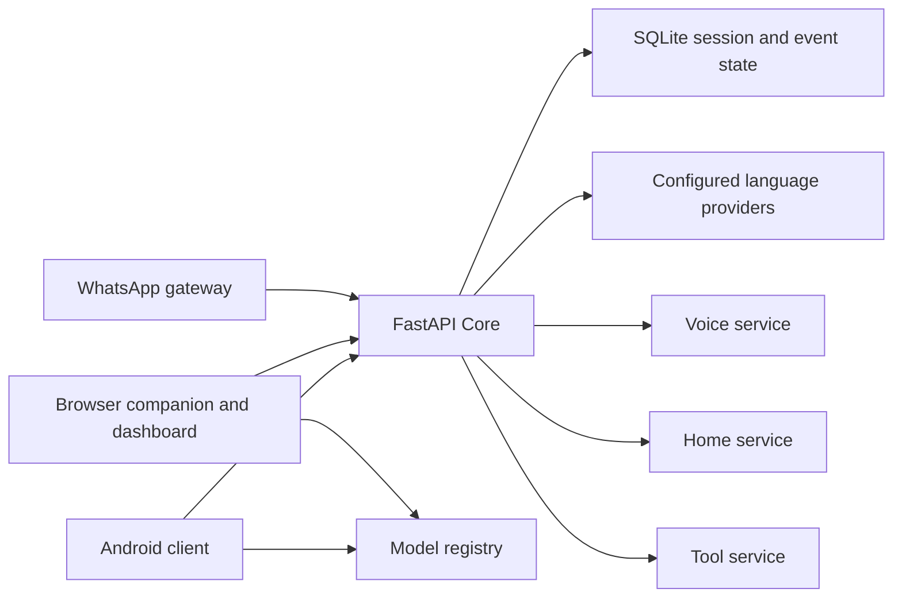

# AstraLily engineering overview

[Repository overview](../README.md) · [Setup](../PUBLIC_SETUP.md) · [Service boundaries](../SYSTEM_BOUNDARIES.md)

AstraLily separates conversation from the services that own hardware, messaging, and model execution. A phone sends one user request to Core; Core can perform multiple provider or service calls before returning the result. A single client request does not imply a single LLM call.

## Recent implementation changes

### Core responsibilities are separated

The current service lives in `lily_essence_core/lily_core/`. Source handlers coordinate requests while dedicated modules contain device dispatch, device language handling, response support, and request progress. This makes device execution and reply generation easier to inspect independently. Moving code into modules does not itself change request concurrency or reduce provider latency.

Trace a request from `service.py` into `handlers.py`, then inspect `device_intent.py`, `device_dispatch.py`, `device_language.py`, and `home_control.py` for conversational device actions. Ambiguous targets require resolution; language support does not guarantee that every command will be interpreted correctly.

### Android has selectable speech input

The Android client can use the device speech recognition service or server transcription. The device route uses Android's SpeechRecognizer API, with Indonesian, English, and Japanese language selection. Availability and network requirements depend on the installed recognition service. The result enters the chat flow; this is distinct from manually using a keyboard's dictation button.

See `MobileVoiceInput.kt`, `VoiceInputSession.kt`, and `PocketRealmViewModel.kt` under the Android client's `ui` package. Input language and synthesized voice language are separate settings.

### Voice generation and playback are separate stages

Core requests synthesis from the configured voice route and returns an audio reference. The frontend then downloads and plays it. A successful chat response or a valid WAV file is not proof that a particular device's speaker played it. Profiles require separately restored voice assets and a compatible running voice service.

### Messaging remains independently configured

The WhatsApp gateway owns delivery and its connection lifecycle. Secretary mode is optional and uses separately configured activation and contact policies. Installing this snapshot is not authorization to enable automatic replies.

## Public scope

The exported components are listed in the root README. IRIS Launcher is included as an optional local Windows setup and service dashboard. The native desktop HUD, its floating Live2D presentation and screen companion, File, Finance, and streaming applications are not shipped in this edition. Browser Private Realm remains the desktop companion.

## Reproducing a demonstration

1. Set up Core and Private Realm with a configured text provider.
2. Send a synthetic message and verify the displayed response.
3. If voice is configured, verify synthesis, audio download, and audible playback separately.
4. If Home is configured, test an explicit device target and an ambiguous target that should require clarification.
5. On Android, exercise each available speech input option and language independently.

Record the source revision, provider/model, service placement, and failed cases with any reported measurements. No cross-device benchmark or production reliability claim is included. SDKs, model weights, credentials, runtime history, and generated media must be restored or generated locally rather than taken from the public snapshot.
